# Control Manager UI (dl-app)

The web app for running DataLoader. Configure source databases and tables, watch loads, crawl a
source's catalog, promote configuration to production, and manage the secrets behind it.

> Screenshots show the running app with example data. The Assets screens show the packaged app
> in Dagster mode with synthetic asset health and build history.

---

## How it runs

The app runs as a Databricks App, deployed from the workspace repo by the app deploy pipeline.

| | |
|---|---|
| URL | The `dl-app` Databricks App in each workspace. Get the current address from the Databricks Apps list |
| Server | gunicorn, 4 workers |
| Deployed by | `databricks apps deploy dl-app` from the workspace repo checkout |
| Secrets | App resources bound to the Key Vault backed scope, referenced by `valueFrom` in `app.yaml` |
| Identity | The `X-Forwarded-Email` header set by the Databricks proxy |
| Databases | Two Lakebase pools, test by default, prod created on demand by the header switch |

### Cluster-backed buttons

Five buttons do real work against a source database by submitting a one-off notebook run on the
dataloader cluster, then polling it.

| Button | Where | What it does |
|---|---|---|
| Test connection | Database config form | Connects with the configured secrets and reports which resolved |
| Crawl source catalog | Table list | Caches every source table's columns, keys, indexes and row estimate |
| Suggest columns | Table form | Reads the source table's columns and ranks them for Incremental and Partition |
| Get partition values | Table form | Reads MIN, MAX and COUNT of the partition column and fills the bounds |
| Preview rows | Table form, source catalog | Reads the first ten rows |

All five need the deployment principal's credentials and the cluster id, and all five are
**disabled on PROD**. The app shows the reason rather than hiding the button silently. A cold
cluster start is the whole wait; the status line says so.

---

## Global chrome

Present on every page.

| Control | Behavior |
|---|---|
| Nav | Dataloader (home), Operations, Runs, Batches, Trends, Error rules, Audit History, Key Vault and Settings. In Dagster mode, Assets appears beside Operations. |
| Find a table, or **Ctrl+K** | Quick open. Enter opens the table's runs and health hub, Shift+Enter opens its configuration |
| Theme toggle | Light and dark, remembered per browser |
| TEST / PROD | Switches which Lakebase database the app reads and writes |
| Timezone badge | Times are shown in `America/Denver` and stored as UTC |

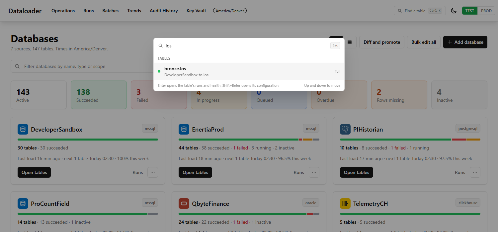

---

## Databases

The landing page. Every source database, how it is doing, and what runs next.

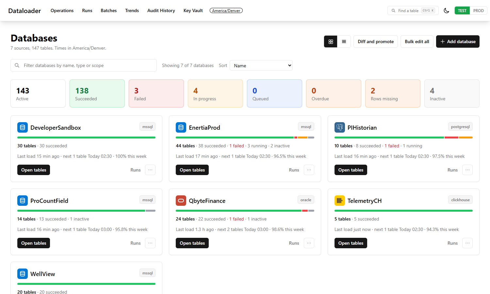

Counters across the top are clickable and lead to the matching status view: Active, Succeeded,
Failed, In progress, Queued, Overdue, Rows missing, Inactive. Rows missing counts the tables whose
last key comparison found source rows with no row in the destination.

Each card carries the database type, a health bar, table counts, when it last loaded, what is due
next, and the week's success rate. Buttons: **Open tables**, **Runs**, and a row menu with Edit
connection, Bulk edit tables, Run all now, and Delete.

Header buttons: card or list view, **Diff and promote**, **Bulk edit all**, **Add database**. When
a configuration exists that no table references, a **Remove orphaned configs** button appears.

---

## Operations

The page to open when something looks wrong. It answers four questions: is anything broken, did the
last window finish, what runs next, and is anything late.

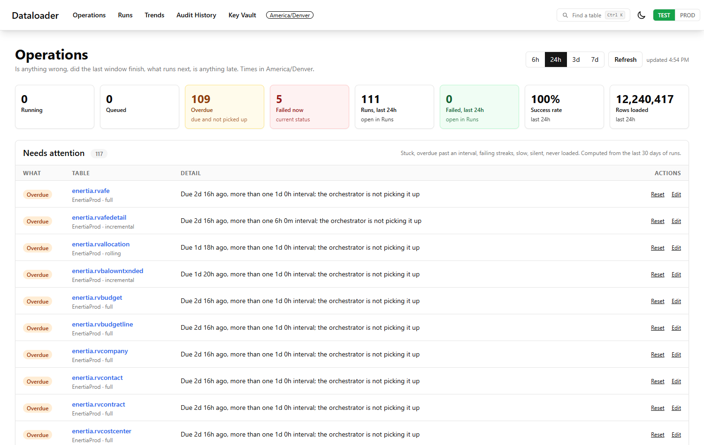

- **Window tabs** 6h, 24h, 3d, 7d, plus Refresh and a last-updated stamp.
- **Health strip**: running, queued, overdue, failing now, runs in the window, failures in the
  window, success rate, rows loaded.
- **Needs attention**: tables that are stuck, overdue past a whole interval, on a failing streak,
  failed, slow, silent, never loaded, or missing source rows at the last key comparison. Computed
  from 30 days of runs. Each row carries the actions that fit it: the last run, Reset, Edit, or
  History. Rows missing never turns a status red, because every load still succeeds.
- **Next N hours** as a timeline or a week heatmap. Bar length is the table's usual duration.
- **Last N hours**: longest runs, most rows, failures.
- **Freshness** by database.

---

## Runs

Every table load in a window, as a table, a timeline, or grouped into batches. The Table, Timeline
and Batches switch keeps the filters.

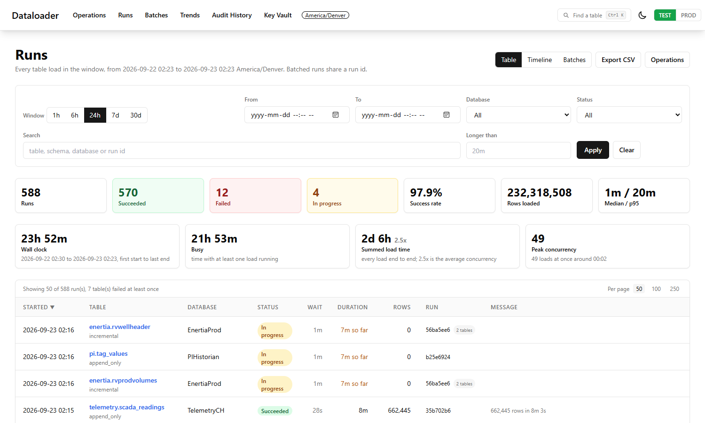

Filters: window chips (1h, 6h, 24h, 7d, 30d), explicit from and to dates, database, status, free
text across table, schema, database or run id, and **Longer than**, which takes `90s`, `20m`,
`1.5h` or a bare number of minutes. Columns sort, including Wait, the time a load sat queued before
it started. Rows link to the Dagster run. **Export CSV** carries the current filters.

Two rows of figures sit above the results. The first counts runs, successes, failures, loads in
progress, success rate, rows loaded, and median and p95 duration. The second says how the window
was spent:

| Figure | Means |
|---|---|
| Wall clock | First start to last end |
| Busy | Time with at least one load running |
| Summed load time | Every load end to end, with the average concurrency it implies |
| Peak concurrency | Most loads running at once, and when |

### Timeline

One bar per load on a wall clock, colored by outcome.

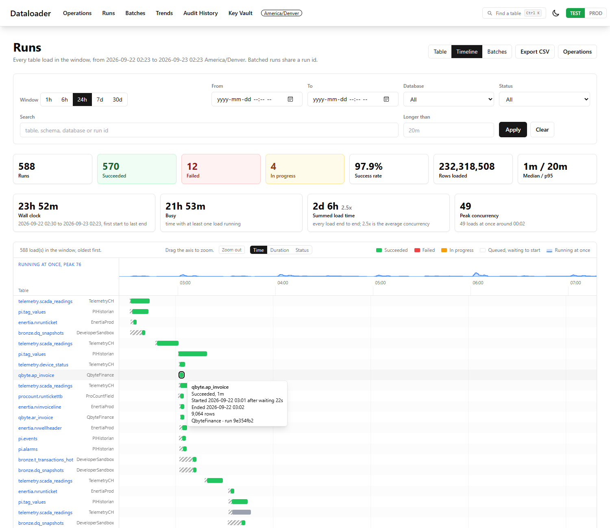

The hatched segment before a bar is the time the load waited in the queue. The strip above the rows
plots how many loads were running at once. Hover a bar for its table, outcome, start, wait, end,
rows, database and run.

- **Drag the axis to zoom.** The drag sets the from and to filters and reloads, so a zoomed view is
  a link you can share and Back undoes it. **Zoom out** doubles the window around its middle. The
  shortest window is a minute.
- **Row order**: Time (oldest first), Duration (longest first, the direct answer to what is taking
  all night), or Status (failed first, then still running). Bars keep their place on the clock; only
  the stacking changes.
- At most 1,000 loads are drawn. Past that the view says how many it left out; narrow the window or
  filter by database.

### Batches

One row per Databricks job run, named by the tables it carried. Also in the nav.

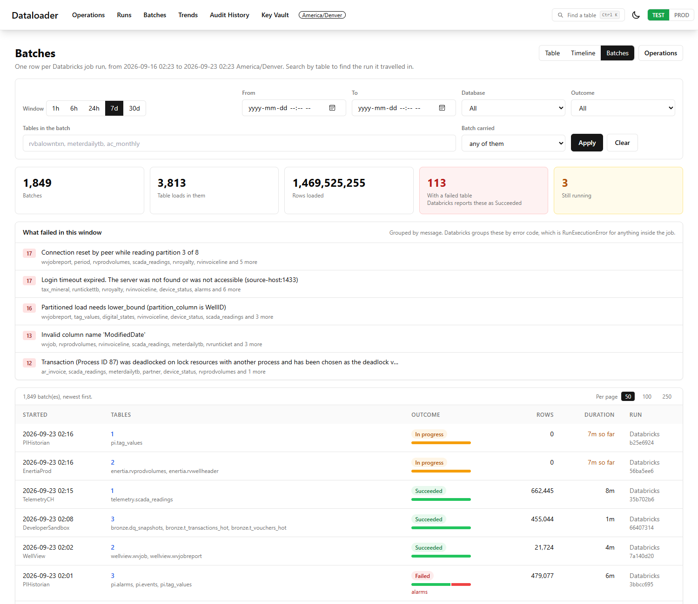

The job is generic and the table list arrives as a run parameter, so the Databricks Runs list shows
every run as Untitled and cannot say what was in it. Every load records the `databricks_run_id` it
ran under, and this page groups on it.

- **Tables in the batch** takes one table or a comma-separated list, and **Batch carried** picks
  whether a batch must carry any of them or all of them. Type a table to find the run it travelled
  in, along with everything else that rode with it.
- **Outcome** is a roll-up of the tables, not the job's exit status. A batch with a failed table
  reads Failed here while Databricks reports it as Succeeded, because the job completed. A bar shows
  the split, with the failed tables named under it. Filter by any table failed, still running, or
  all clean.
- **What failed in this window** groups the failures by message and lists the tables each one hit.
  Databricks groups them by error code, which is RunExecutionError for anything inside the job.
- The table count links to that batch's loads in the Runs table. The Run column links to the
  Databricks run and the Dagster run.
- A load that never reached Databricks groups under its Dagster run instead, so nothing falls off
  the page.

### Table hub

One table's whole story: state now, configuration, recent runs with sparklines, what needs
attention, and recent configuration changes. This is where Ctrl+K lands.

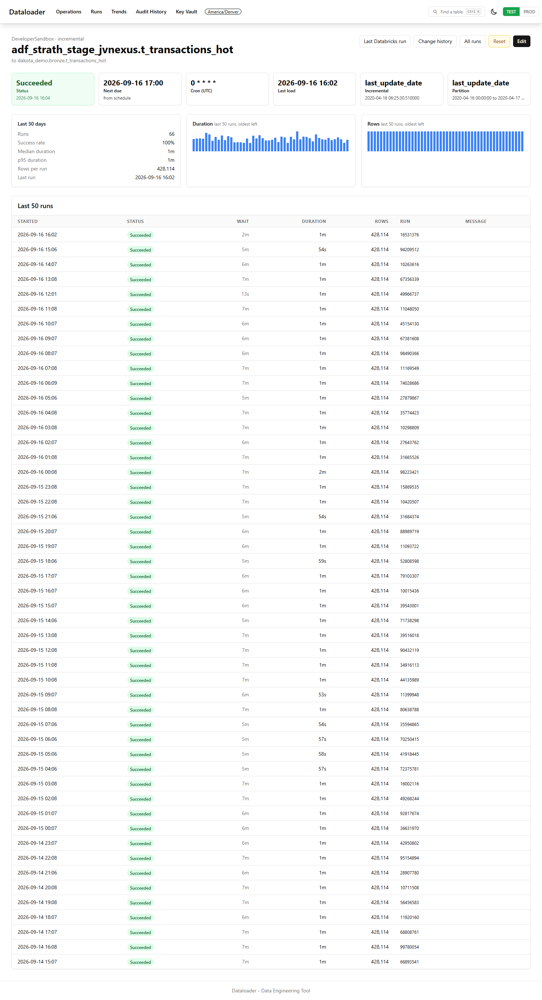

---

## Trends

Twelve weeks, one point per week: success rate, rows loaded, run duration at p50 and p95, and
failures by database. Hover any mark for the exact numbers.

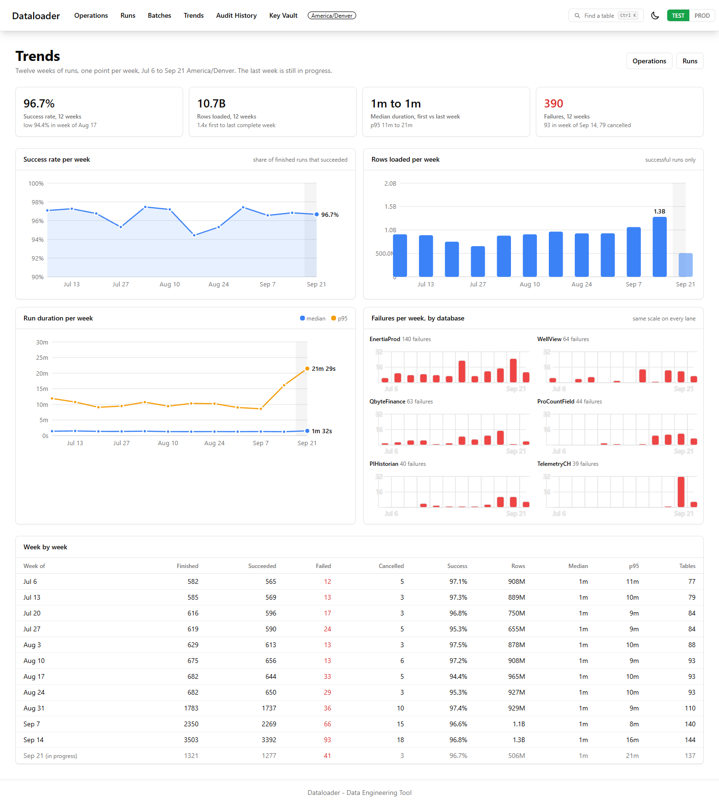

---

## Tables

### Table list

Every table for one database.

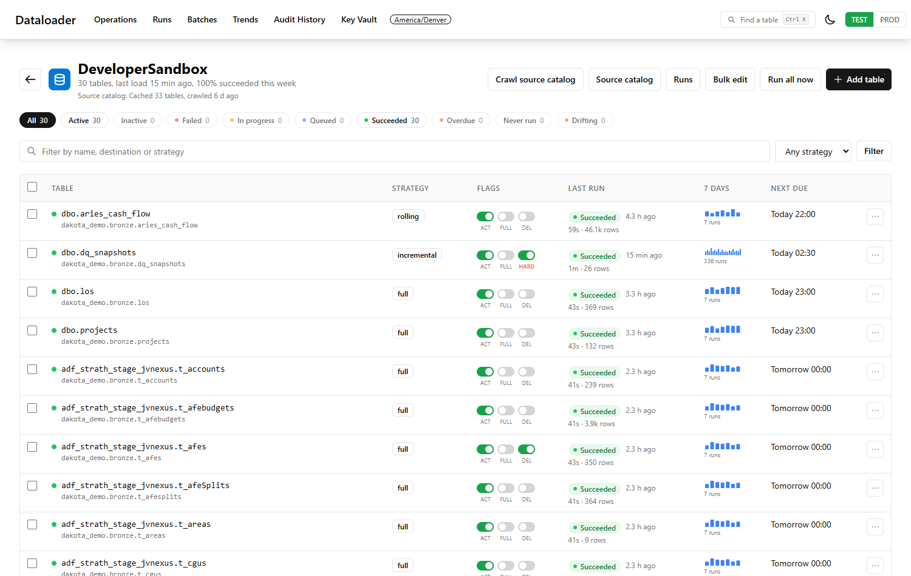

- **Filter chips with counts**: All, Active, Inactive, Failed, In progress, Queued, Succeeded,
  Overdue, Never run. Filtering to Failed adds a **Reset all failed** banner.
- **Crawl source catalog** with a live status line, and a **Source catalog** link once a cache
  exists.
- Search by name, destination or strategy, plus a strategy filter.
- Checkboxes with **select all matching** across pages, then Activate, Deactivate or Delete.
- Three toggles per row: Active, Full load, Mark deletes. The status pill opens the error.
- A table whose last key comparison found rows missing is marked with the count, so drift is
  visible from the list without opening anything.
- Row menu: Runs and health, Edit, Change history, Reset, Clone, Delete.

### Source catalog

The cached result of a crawl, with checkboxes to create table configurations in bulk.

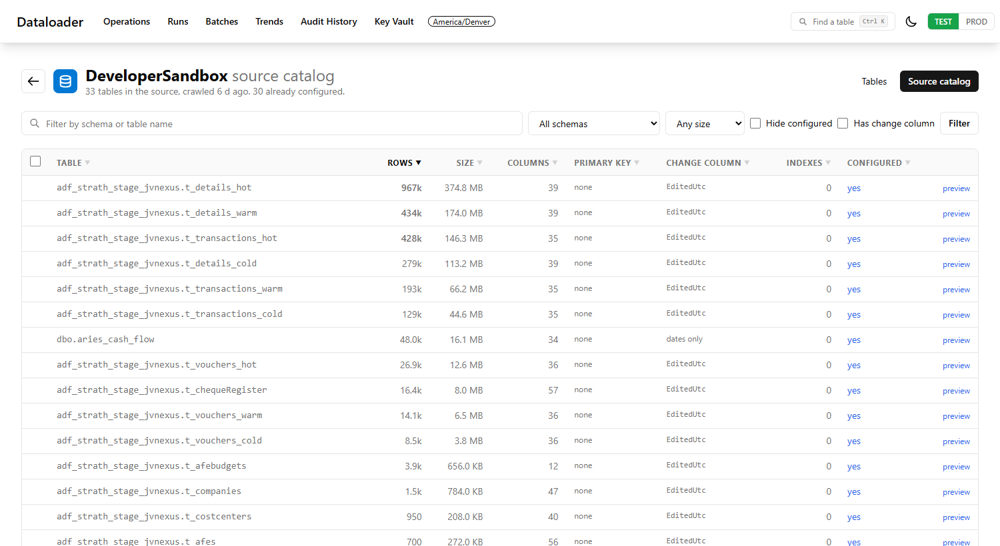

Columns sort, so you can find the biggest tables in a source by clicking Rows. Filters: schema,
minimum rows, hide already configured, and **has a change column**.

**Change column** is the crawl's best guess at an incremental cursor, ranked by what the name says:
a SQL Server rowversion first, then a modified-looking timestamp, then a created-only one. Business
dates are never suggested. Tick some rows, pick a strategy, and **Create configs** derives each
table's primary key, destination name, partition column and incremental column from the cache.

Every row has a **preview** link.

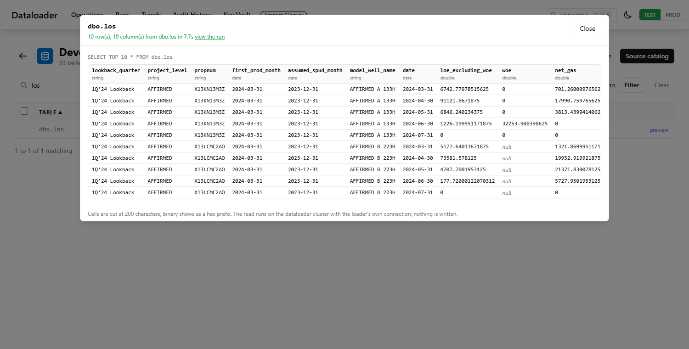

### Add and edit a table

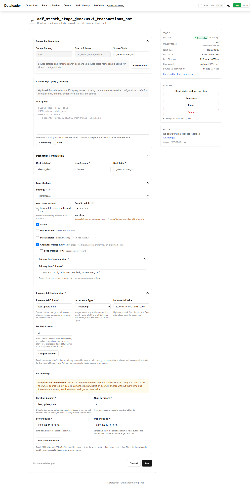

Sections: Source, Custom SQL (with Format SQL), Destination, Load Strategy, Primary Key,
Incremental Configuration, Partitioning, Advanced. Strategy-dependent fields swap in when the
strategy changes.

What the controls do:

| Control | Notes |
|---|---|
| Full Load Override | One-time forced reload; resets itself after the load succeeds |
| Mark Deletes + mode | Soft flags the row and keeps it, hard removes it. Needs a primary key |
| Check for Missed Rows | Compares source and destination keys and reports rows no incremental run can see. Needs a primary key, and is separate from Mark Deletes: neither switch turns on the other. The hint beside it says what the check costs, which is nothing when Mark Deletes is already on, and says when it is unavailable because the table uses a custom SQL query |
| Load Missing Rows | Reads the missing rows back from the source by key and merges them, instead of only reporting them. Costs the share of rows missing, where a full reload costs the whole table. Off by default because it writes rows, and only available while Check for Missed Rows is on. Capped at 50,000 rows (`DATALOADER_DRIFT_REPAIR_MAX_ROWS`); past that the loader says a full reload is the better tool |
| Dev Full Load | Bypasses the 1000 row dev catalog limit |
| Lookback hours | Hours re-read below the cursor. Blank uses the loader default of 12 |
| Cron | Shown and edited in display timezone, stored as UTC, with a live description |
| Preview rows | The first ten rows of the source, read on the cluster |

The right rail shows current state, run links, and actions: Reset status, Activate, Clone, Delete,
and a collapsed block for setting the status by hand while testing.

**Usually takes** is the median of the last 30 days of successful runs. It uses only runs of the
current strategy when there are at least three, because a table that backfilled and then went
incremental has two unrelated sets of durations. Otherwise it uses every successful run and says
so, and with fewer than three of those it shows nothing.

While a load runs, the rail adds **Running for** and **Estimated left**. Once the run is past its
usual duration the line becomes **Past the usual** and says by how much, since a median of
five-minute runs cannot say how much longer an hour-long run will take.

Two rail lines report whether the destination still matches the source:

| Line | Reads | Says |
|---|---|---|
| Row counts | Recorded after every load, both sides from metadata | `in step` with the row total, or both numbers and the percentage apart. Marked `(estimate)` where the engine only estimates its row count |
| Source vs destination | The key comparison, when Mark Deletes or Check for Missed Rows is on | `in step`, or how many source rows have no row in the destination, with when it last ran |
| Rows loaded back | The last repair, when Load Missing Rows is on | How many rows were read back and merged, and when |

Counts see net drift only, so the two lines can disagree: equal counts with rows missing means as
many rows were dropped as were missed. The key comparison is the one that proves anything.

**Suggest columns** reads the source's columns, keys and indexes, and grades each one for use as an
incremental cursor and as a partition column, with the reason spelled out.

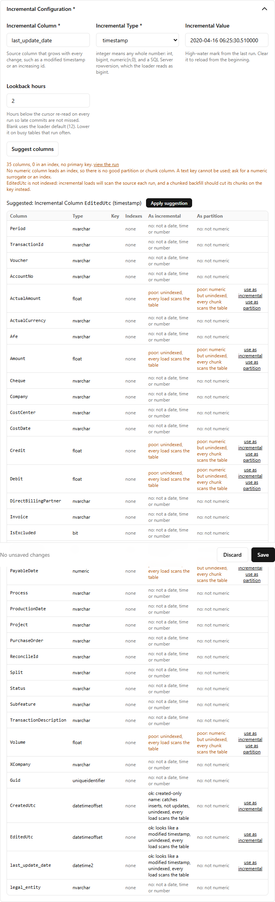

### Create a table

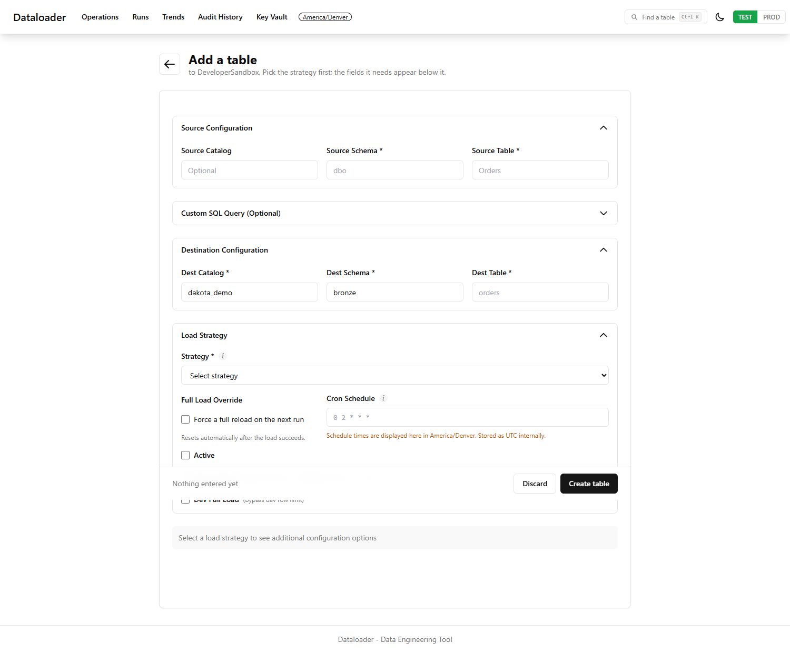

---

## Database configuration

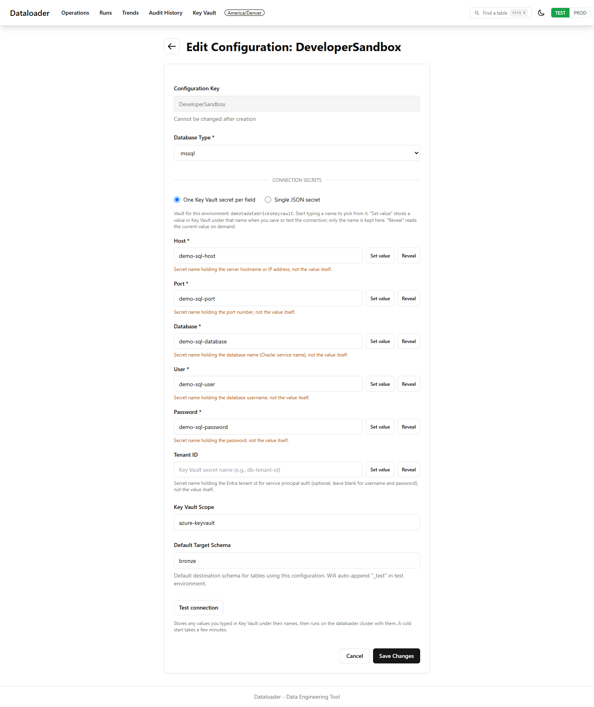

Types: `mssql`, `oracle`, `postgresql`, `snowflake`, `snowflake_pem`, `clickhouse`, `s3_iceberg`.
Changing the type swaps the fields.

Secrets are never stored in the control database. Each field holds the **name** of a Key Vault
secret. Two layouts are offered: one secret per field, or a single secret holding a JSON bundle of
all of them, with a template per database type.

Per field you can **Set value** (write the value into Key Vault on save) and **Reveal** (read the
current value on demand). **Test connection** proves it works before you save.

---

## Bulk edit

Open **Bulk Edit** from a database's table list, or **Bulk Edit All** to work across connections.
The packaged app uses RevoGrid. Click a heading to sort and use its filter button to narrow the rows.

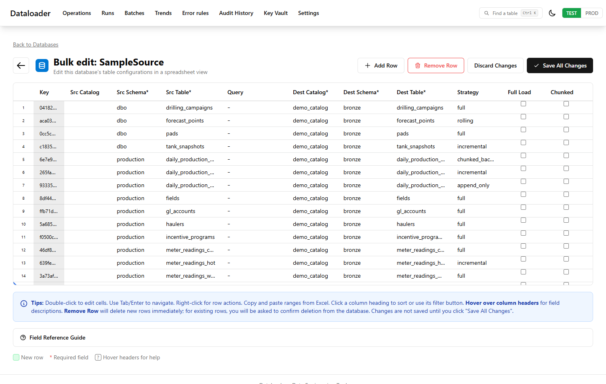

Double-click a cell to edit it. You can change the destination, query, strategy, schedule and load
options. Choose the database and source table when adding a row. Those source fields are read-only
on saved rows.

Use **Ctrl+C** and **Ctrl+V** to copy and paste ranges. Pasting one value fills a selected range.
Checkboxes accept values such as `yes` and `no`. Use **Ctrl+Z** to undo a paste before saving.

Click **Save All Changes** to submit the rows you edited. A filter changes which rows you see.
Edits you made before filtering are still pending. Check **Audit history** for the saved changes.
Removing an existing row takes effect when you confirm **Remove Row**.

---

## Assets in Dagster mode

Open **Assets** in the main navigation when Dagster schedules your loads. This is where you can
follow a source table into downstream dbt models and see why a model is waiting. Bronze table
status comes from the loader. Model health, checks and sensor status depend on Dagster publishing
to the selected environment's control database. Check the publication age before acting on a stale status.

### Assets and asset detail

Start with **Needs attention** to investigate a problem, or choose **All** to browse healthy assets
too. Search by table, model or description and narrow the list by layer, domain or source.

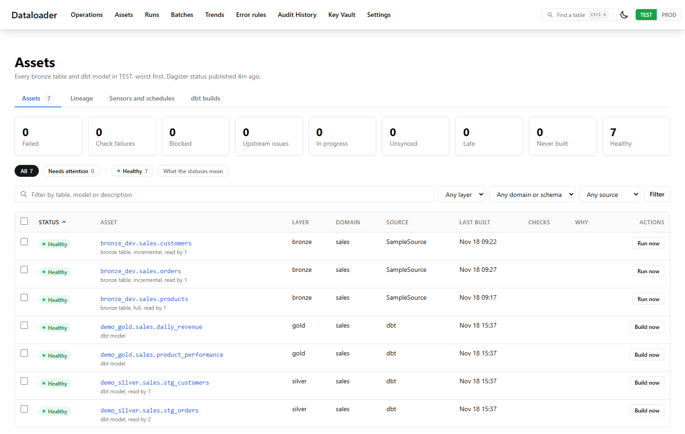

Select an asset's name to see its detail. **Reads** lists its inputs and **Read by** lists its
consumers. Use **Checks** for the result of a data test. A bronze table also shows its loader
configuration. Choose **Lineage** to follow dependencies across several levels.

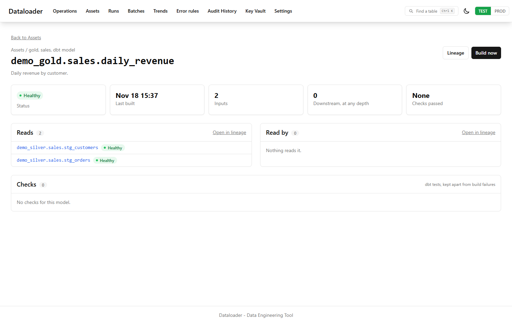

### Lineage

Open **Assets → Lineage** for the whole project. Enter an asset name and choose **Focus** to trace
its upstream inputs and downstream consumers. Adjust **Upstream** and **Downstream** to control
how many levels you see. A dashed connection can pass through a catalog hidden by the filter.

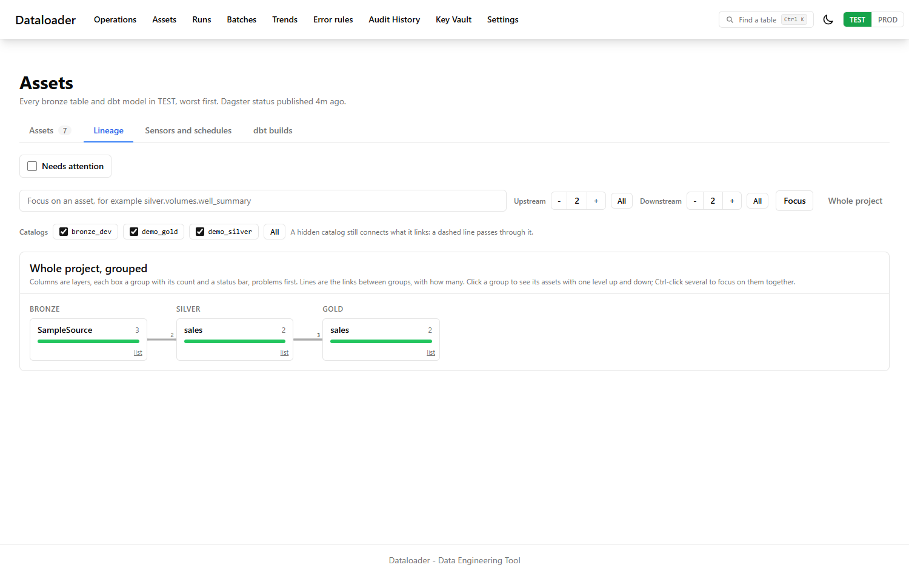

### Sensors and schedules

Open **Assets → Sensors and schedules** if loads or builds have stopped arriving. Compare the last
tick with the expected interval and read the last result. The **Stops if it stops** column tells
you which work depends on that sensor or schedule.

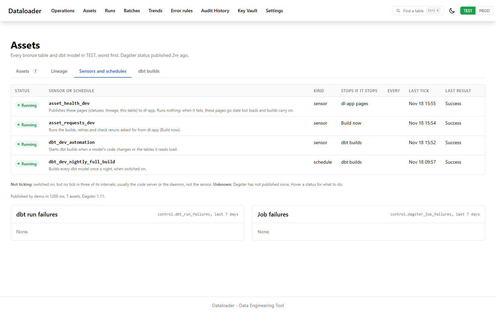

### dbt builds

Open **Assets → dbt builds** and select a day. **Repeat builds** shows which models ran more than
once. Use it to investigate repeated work before changing a schedule.

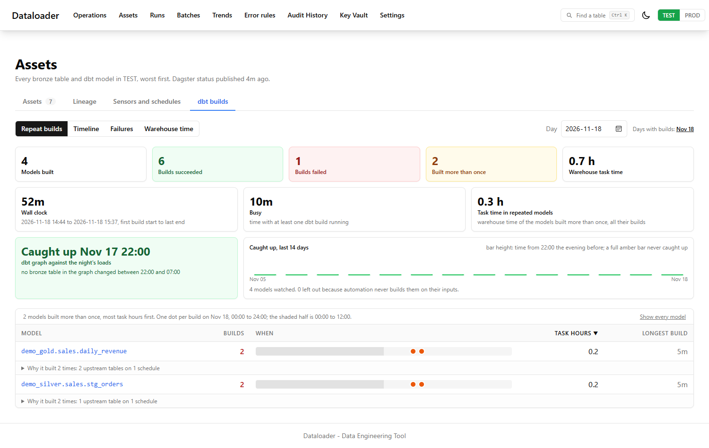

Switch to **Timeline** to see when each build ran and which models were on the critical path.
Use **Failures** to investigate failed builds. **Warehouse time** shows compute consumed by
warehouse tasks over the selected window. Parallel tasks can sum to more than the elapsed time.

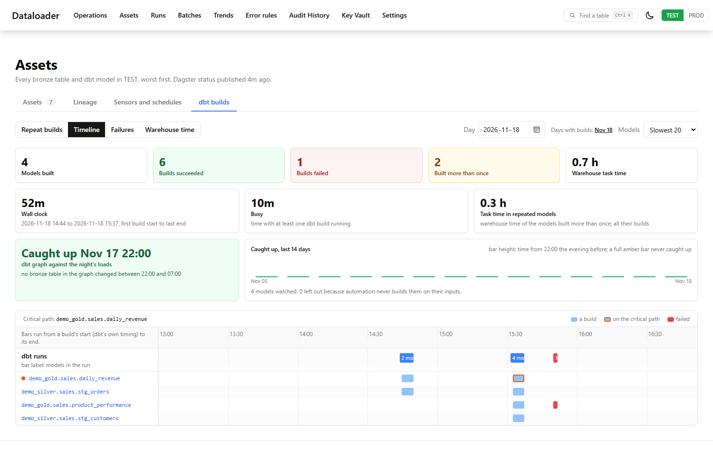

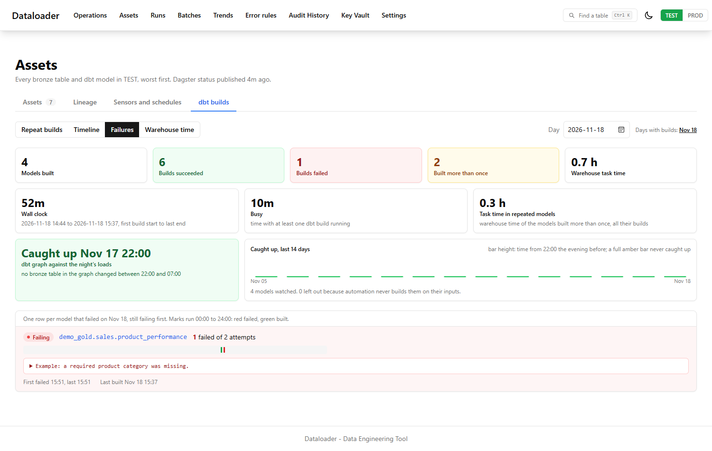

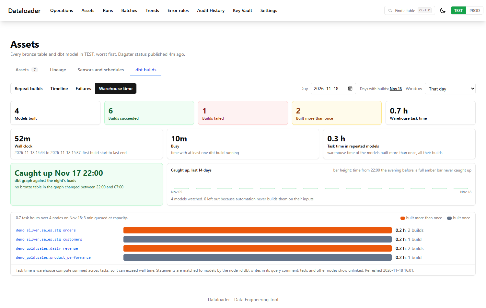

---

## Status views

One status at a time, across every database.

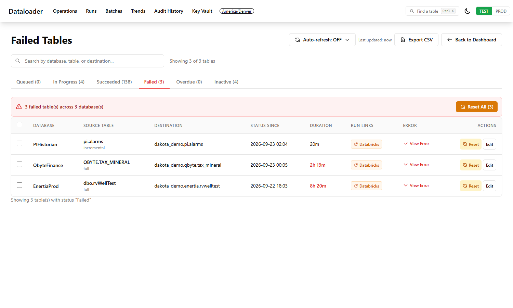

Tabs carry counts: Queued, In Progress, Succeeded, Failed, Overdue, Inactive. Each row expands to
its error, with copy to clipboard.

- **Auto-refresh** at 10s, 30s, 60s or 5m, with a countdown. Selections survive a refresh.
- **Reset selected** or **Reset all**, and on the Inactive view, Activate.
- **Export CSV**.

Resetting a table clears its status so the next sensor tick picks it up.

---

## Promote to prod

Compares test against production and moves configuration across. Nothing here touches data; it
moves rows in `table_control` and `table_control_dbconfig`.

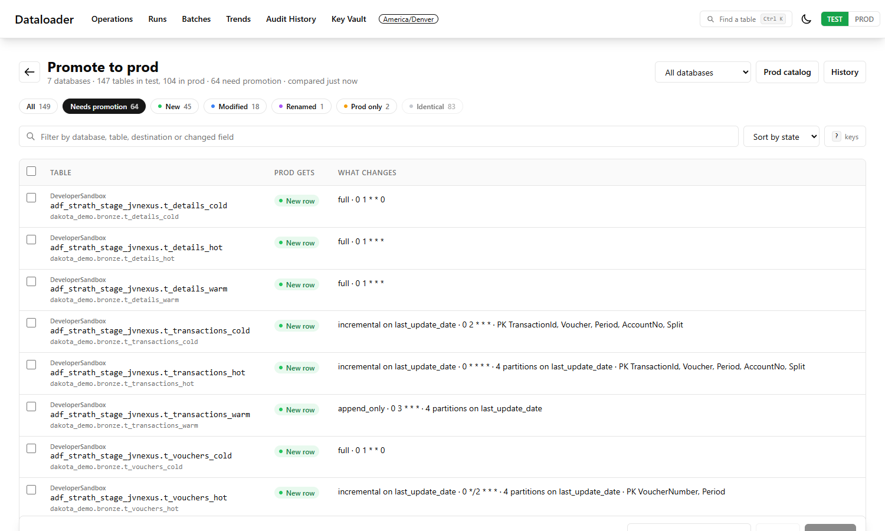

State chips: All, Needs promotion, New, Modified, Renamed, Prod only, Identical. Expand a row to see
exactly which fields differ.

**Preview** shows what would be written before anything is written: inserts, updates, renames, the
database configuration that would be copied, and a **Key Vault check** listing secrets that are
missing from the production vault, with a checkbox to copy each one across. Values are never shown.
Promote then runs in one transaction.

**Delete from prod** removes rows that exist only in production, leaving the same audit record a
manual delete would.

### Keyboard shortcuts

Press `?` on the page for this list.

| Key | Action |
|---|---|
| `[` `]` | Previous or next database |
| `j` `k` or arrows | Move the row cursor |
| `x` or space | Select the row |
| `Enter` | Expand the row's changes |
| `1`-`7` | Switch state chip |
| `/` | Focus the filter |
| `a` | Select all needing promotion |
| `c` | Clear selection |
| `p` | Preview |
| `?` | Toggle help |

---

## Key Vault explorer

Browse and manage the secrets the database configurations point at.

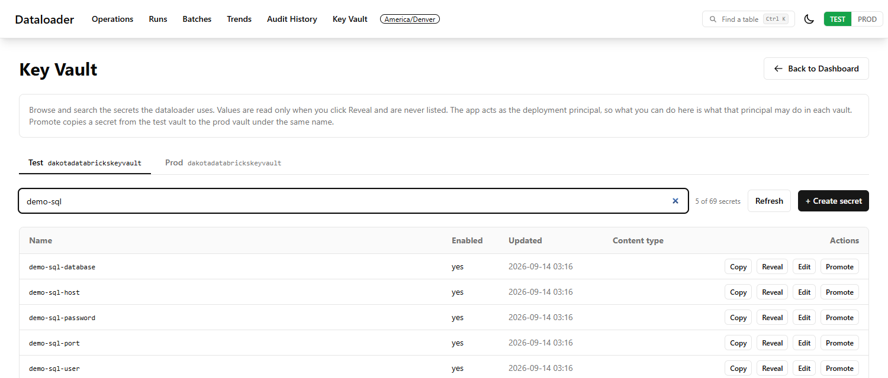

Switch between the test and prod vaults. Per secret: **Copy** the name, **Reveal** the value on
demand, **Edit** to write a new version, and **Promote** to copy it to the prod vault under the same
name. **New secret** offers a connection bundle template per database type.

Values are only ever fetched when you ask for one. The list itself carries names and metadata only.

---

## Error rules

Use **Error rules** to decide how the retry analysis handles recurring load failures. Check the
**TEST** or **PROD** badge before changing a rule.

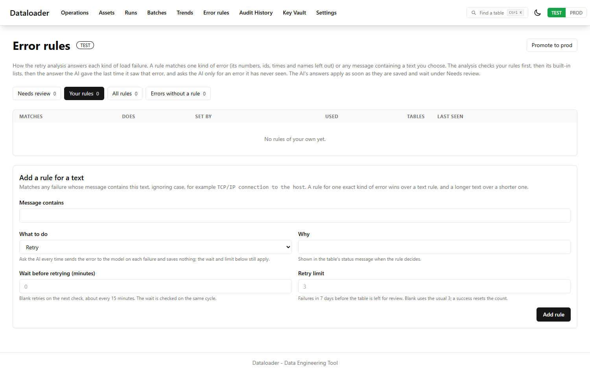

- Under **Needs review**, check AI-suggested rules. Those rules take effect when saved by the
  retry analysis. **Looks right** marks a rule reviewed, and **Change** lets you set a decision.
- Under **Errors without a rule**, use **Add rule** to match a specific kind of failure. Under
  **Your rules**, enter a case-insensitive message fragment to match several related failures.
  A rule for one kind of failure takes priority over a text match. Among matching fragments, the
  longest wins.
- For a retry, you can set a delay and a limit. When the limit is reached, the table is left for
  review. Use **Promote to prod** to compare TEST and PROD rules and select which to copy.

---

## Settings

Use **Settings** to set the global run timeouts for the selected **TEST** or **PROD** environment.

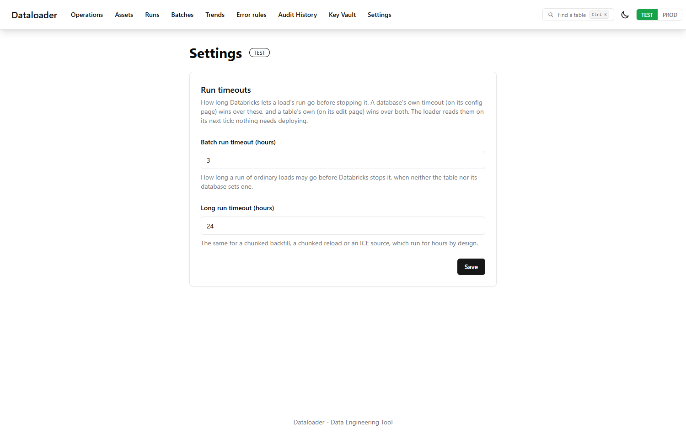

**Batch run timeout** applies to ordinary loads. **Long run timeout** applies to chunked backfills,
chunked reloads and other loads the scheduler classifies as long. The standard defaults are 3 and
24 hours, respectively. Enter a whole number from 1 to 72 and select **Save**.

A table's own timeout takes priority. An ordinary load otherwise uses its database timeout if one
is set. A long load can use the database timeout when it exceeds the global long-run value. The
scheduler reads saved settings on its next tick.

---

## Audit history

Every configuration change across every table, with filters for date range, user, change type,
change source and database.

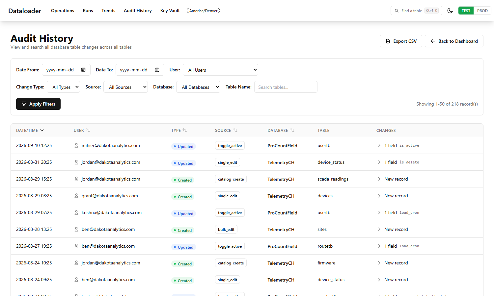

Entries expand to show old and new values. **Export CSV** carries the filters.

`change_source` says what made the change: the app, a bulk edit, a promotion, the loader itself. A
source of `backfill_complete` means a chunked backfill finished and handed the table over to the
incremental strategy.

### Per-table history

The same audit trail for one table, reachable from the table list row menu and from the edit page.

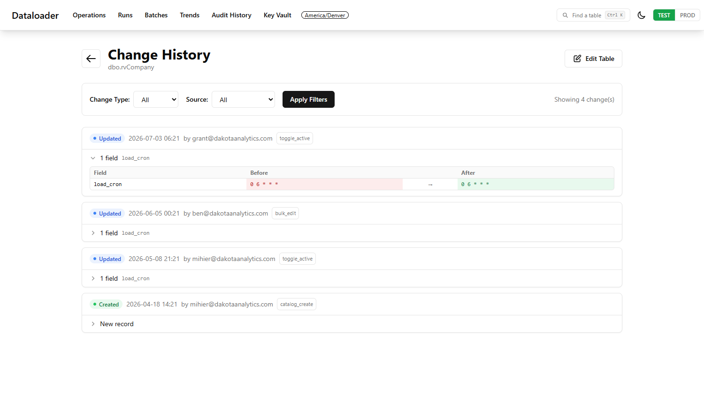

---

## Related documentation

- [Common Tasks](08-common-tasks.md), the recipes most of this UI exists to serve
- [Lakebase Control Database](02-lakebase-control-database.md), what the forms write
- [Load Strategies](05-load-strategies.md), what the strategy fields mean
- [Troubleshooting](06-troubleshooting.md)
