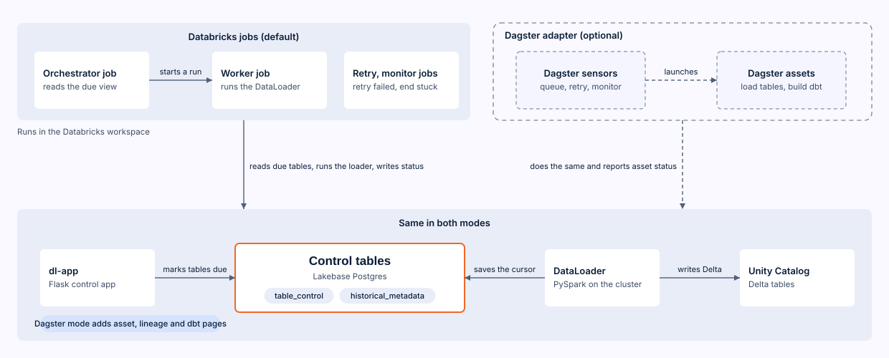

# Packaged installation and operation

Dakota installs the software, connects the sources, and trains your team. Once a source is connected, an operator can add tables, schedule them, promote a reviewed configuration and investigate a failure from the control app.

## Which scheduler does this installation use?

| | Databricks Jobs, the default | Dagster |
|---|---|---|
| Who starts a scheduled load? | The orchestrator job reads due control rows and submits a batch to the worker job. | The master sensor reads due control rows. A Dagster asset launches the batch on Databricks using Pipes. |
| Where does the load execute? | A classic Databricks cluster runs the installed wheel and writes Delta tables. | A classic Databricks cluster runs the same loader. |
| Where does the operator look? | Open **Runs** in the control app. Follow the Databricks run link when you need worker details. | Start in **Runs** for loads. Use the [Assets walkthrough](07-control-manager-ui.md#assets-in-dagster-mode) for model health, lineage, sensors and dbt builds. |

Scheduled loads start from control rows. Some operator actions, including previewing source rows and testing a connection, submit helper tasks directly. A successful preview establishes source access. A load also needs permission to write the destination.

## What Dakota sets up

Dakota installs a versioned `dakota-dataloader` wheel on classic compute with Python 3.11 or later and the source's JDBC drivers. The deployment bundle supplies job runners, the app configuration, migrations and a deployment guide. The control database holds table settings and history. Secrets stay in the deployment's secret scope.

The installer applies the database migrations, configures the app's session key and secret bindings, selects the scheduler, and verifies a small load before enabling schedules. On dedicated compute, the job's run identity must match the cluster's assigned identity. A workspace administrator grants the required source and destination access. The installer and operator should know which person owns each permission.

## Operator handoff

1. In the **test** environment, open the source database and add an inactive table. Check its source, destination, strategy and schedule. Use **Preview rows** to confirm the source.
2. Run a controlled load. Open **Runs**, find that table, and check the outcome and rows processed. During training, verify the destination rows as well. Record where the team can find the run and table history.
3. Open the promotion view and compare the test configuration with production. Review the selected rows, including any deletions. Use **Promote Selected** only when the production change has been approved.
4. Practice diagnosing a synthetic failure. Save the run link, table, error and timestamp. A credentials or permission error goes to the person who owns that access. Verify the cause is fixed before resetting the table.

To change several table configurations together, open the [bulk editor](07-control-manager-ui.md#bulk-edit). During training, paste a value into two inactive test rows, save, and find both changes in the audit history.

If the orchestrator reports that submission was unconfirmed or that it could not save a run link, inspect the worker's Databricks runs for that time and batch before resetting anything. A worker may have accepted the load. Compare its result with the table history and destination before requesting a replay.

For upgrade and control-database recovery, use the deployment guide and database README delivered with the installed version. The installer should rehearse restoring a backup to a separate database and compare cursor values with the destination before restarting schedules.

The [control app walkthrough](07-control-manager-ui.md) shows the operating screens. [Load strategies](05-load-strategies.md) explains how to choose a cursor, replay a window and backfill a table.
